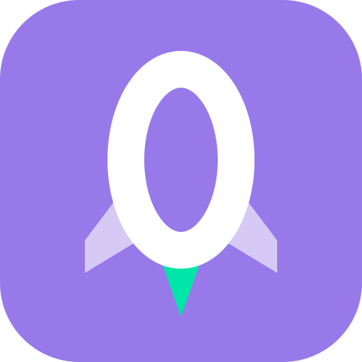
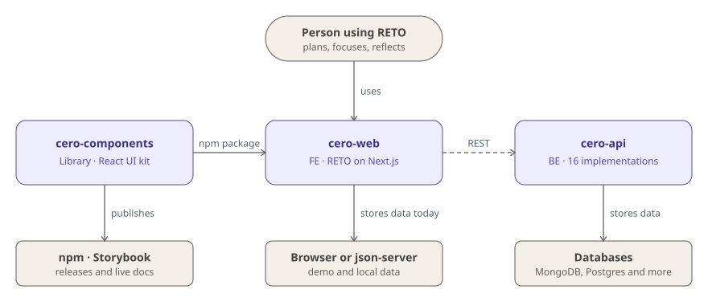
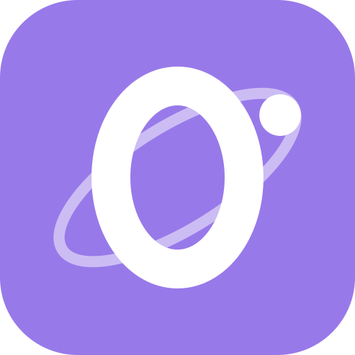
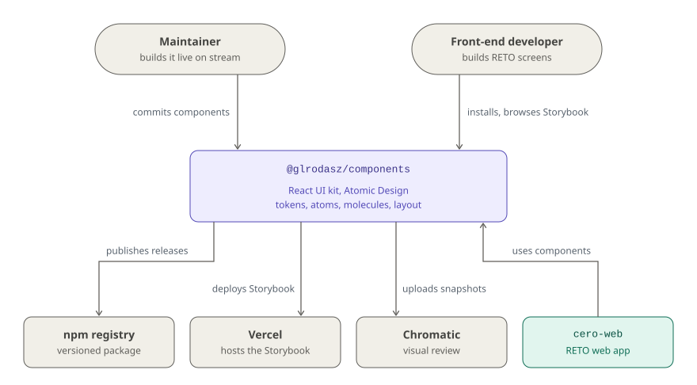
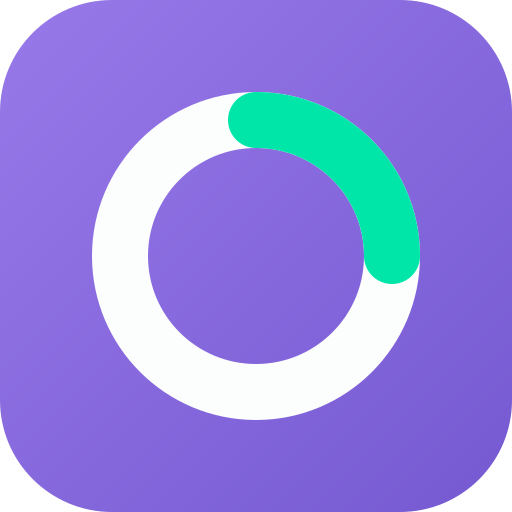
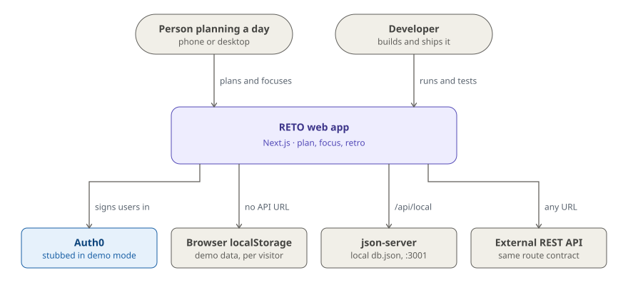
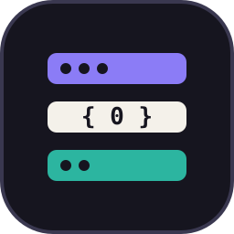
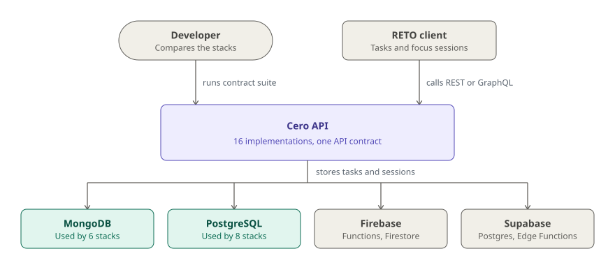

# Cero

0️⃣ 🚀 **Cero** is the project behind **RETO**, a productivity app built from
scratch to production in public: real decisions, failing tests, refactors and
all.

 

It started as **Cero a Producción** (Spanish for "Zero to Production"), a series
of live coding sessions streamed in 🇪🇸 Spanish on Twitch. The sessions built the
components library and the web app, and started the API. The recordings are on
YouTube.

📺 [YouTube](https://germo.me/youtube-cero) · 🟣 [Twitch](https://germo.me/stream)

This repository is the entry point to the project: the code lives in the repos
below, and may eventually be merged here as a monorepo.

## The idea behind

The goal was to show an authentic developer experience, every decision a working
programmer makes on a daily basis with JavaScript and other tools. That meant
failing tests, refactors, Google and StackOverflow searches, and the eternal
struggle of naming things.

## How it fits together

<picture>
  <source media="(prefers-color-scheme: dark)" srcset="assets/diagrams/overview-dark.svg">
  
</picture>

Three repositories, one per layer. The **library** (`cero-components`) holds
RETO's design tokens and components and ships them to npm. The **frontend**
(`cero-web`) is the RETO app itself, built from those components. The
**backend** (`cero-api`) serves the same tasks and focus sessions API the
frontend speaks, implemented in several stacks. The frontend picks its backend
with one variable, `NEXT_PUBLIC_API_URL`, which is where a `cero-api`
implementation plugs in.

## The repositories

###  1. Components library ([`cero-components`](https://github.com/glrodasz/cero-components))

The React UI kit behind RETO, published to npm as `@glrodasz/components`: 26
Atomic Design components (atoms, molecules and layout primitives) on 337 CSS
design tokens. Every component is built in Storybook, every story is snapshot
tested, and semantic-release publishes a new version from conventional commits.

**Stack:** React 19, CSS Modules, design tokens as CSS custom properties,
Storybook 10, Vitest, Chromatic, semantic-release.

<picture>
  <source media="(prefers-color-scheme: dark)" srcset="assets/diagrams/cero-components-context-dark.svg">
  
</picture>

[npm](https://www.npmjs.com/package/@glrodasz/components) ·
[Storybook](https://cero-components.vercel.app)

###  2. Web app ([`cero-web`](https://github.com/glrodasz/cero-web))

RETO itself: plan the day, cap what is in progress, and focus with a timer that
offers a break after every completed task, then close with a short
retrospective. Task and focus session rules live in feature commands, so they
behave the same whichever store sits behind them: the browser's `localStorage`
in the [public demo](https://reto.guillermorodas.com/), `json-server` in local
development, or an external REST backend.

**Stack:** Next.js 15 (pages router), React 18, React Query, Auth0,
`@glrodasz/components`, Jest, TestCafe.

<picture>
  <source media="(prefers-color-scheme: dark)" srcset="assets/diagrams/cero-web-context-dark.svg">
  
</picture>

[Live demo](https://reto.guillermorodas.com/)

###  3. API ([`cero-api`](https://github.com/glrodasz/cero-api))

The RETO backend, built 16 times in 6 languages (TypeScript, Python, Go, Rust,
PHP and Elixir) over REST and GraphQL. Every implementation passes the same
black-box contract suite, frameworks of the same language share one core, and
each database is an adapter behind the core's storage ports.

**Stack:** Express, Fastify, NestJS, GraphQL Yoga, FastAPI, Strawberry, Gin,
Fiber, Axum, Actix Web, Laravel, Phoenix · MongoDB, PostgreSQL, Firestore,
Supabase.

<picture>
  <source media="(prefers-color-scheme: dark)" srcset="assets/diagrams/cero-api-context-dark.svg">
  
</picture>

[API contract](https://github.com/glrodasz/cero-api/blob/main/shared/api-contract.md)
